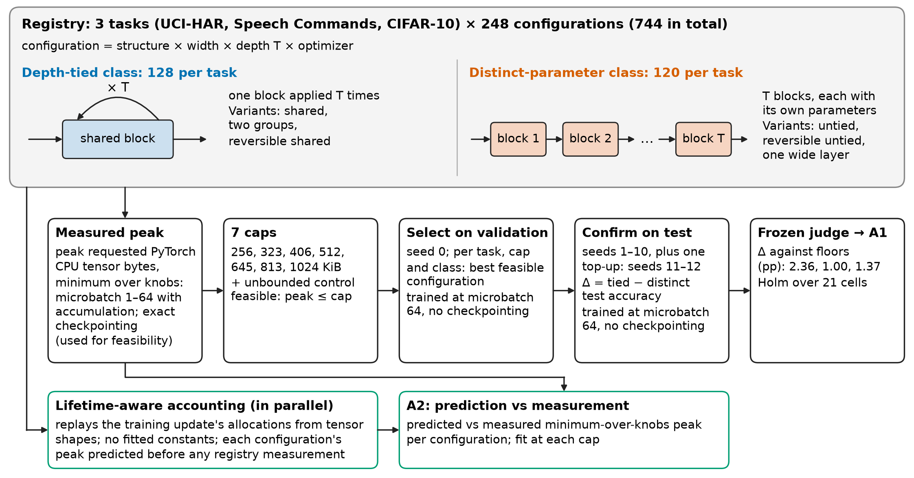

# Depth tying under a training-memory cap: a preregistered common-cap comparison with exact feasibility accounting

## Summary

Depth tying reuses the parameters of one block at several depths of a network, so a deep model stores fewer distinct
weights, gradients and optimizer states. We asked whether, when every model must fit the same cap on training memory,
the most accurate depth-tied MLP-Mixer beats the most accurate model with distinct parameters per layer, and whether
an exact byte accounting can say in advance which configurations fit a cap. We measured the peak requested PyTorch CPU
tensor bytes of one training update for 744 configurations on three small tasks (UCI-HAR, Speech Commands, CIFAR-10),
selected the best feasible configuration of each class at seven caps, and compared their test accuracy over 12 paired
seeds under a frozen, preregistered decision rule. Tying let more configurations fit at 20 of 21 caps, but no cap
showed a tied accuracy advantage larger than its preregistered floor, so the accuracy comparison is inconclusive under
the frozen rule; the accounting predicted all 744 measured peaks exactly. Accuracy was measured at microbatch 64,
where every selected configuration exceeds its cap; the caps are met at each configuration's memory-minimal setting
(microbatch 1, with checkpointing for most), and the two settings are assumed to train the same model up to
floating-point reordering (see Limitations). "Preregistered" means frozen with a SHA-256 hash in this project's
version history before any confirmatory run; nothing was deposited with a third party. The scope is one model family,
three small tasks and CPU tensor bytes, not device memory.

## The two questions and their results

Every number below is read from `research/s4/judge_final_20261011T054347Z.json` (the frozen judge),
`research/s4/selection.json` and `research/s8/derived_numbers_20261011T111328Z.json`.

**A1. At a common cap, is the best depth-tied configuration more accurate than the best distinct-parameter one?**
Result under the frozen rule: **INCONCLUSIVE**.

- Test: per (task, cap) cell, a paired t test of the accuracy difference Δ = tied − distinct-parameter over 12 seeds
  (seeds 1–10, then a preregistered top-up to 12 because the first look at 10 seeds ended in MISS), one-sided against
  a per-task floor; Holm correction over the 21 finite-cap cells (3 tasks × 7 caps); an intersection–union FAIL rule
  (FAIL only if every cell's one-sided 95% upper bound lies below its floor).
- No cell has a tied advantage above its floor (no Holm-significant E+ event).
- 18 of 21 one-sided 95% upper bounds lie below the floor. The three that do not are Speech Commands at 406, 645 and
  813 KiB: mean Δ +0.81, +0.77 and +0.77 points, upper bounds 1.29, 1.14 and 1.14 points against a floor of 1.00.
  These three cells keep the result from FAIL, and with the top-up seeds already used the rule returns INCONCLUSIVE.
- UCI-HAR: the distinct-parameter selection leads by 0.29–1.09 points at every cap (floor 2.36).
  CIFAR-10: the distinct-parameter selection leads by 0.39–2.47 points at every cap (floor 1.37).
- One E− event (distinct-parameter advantage beyond the floor): CIFAR-10 at 406 KiB, Holm-adjusted p = 0.028 in the
  final look; with Holm applied over both looks pooled (42 tests) the same event has p = 0.055.

**A2. Does exact byte accounting predict which configurations fit a cap?** Result: **PASS** on both preregistered
criteria.

- N2.1 PASS: the accounting predicted 744 of 744 measured registry peaks exactly (maximum relative error 0), and
  classified 928 of 928 boundary pairs correctly (a configuration and a cap whose measured peak lies within ±20% of
  the cap).
- N2.2 PASS: exact McNemar tests on the 928 boundary pairs against three static estimates (parameter count × optimizer
  state slots; weights + gradients + optimizer state; a static four-component sum that adds saved activations). The
  static estimates were right on 54.3%, 54.3% and 54.5% of the pairs; the discordant pairs were 424, 424 and 422 in
  favour of the accounting and 0 against; Holm-adjusted p about 1e-127 for each.
- Direction of the errors: every static estimate is below every measured peak (0.28–0.95 of it), so near the caps
  all their errors are false fits. They admitted 424, 424 and 422 of the 428 boundary pairs that do not fit and
  rejected none of the 500 that fit; their accuracy of about 54% is close to the share of boundary pairs that fit
  (500 of 928, 53.9%).

Descriptive, outside the frozen protocol: in the selected depth-tied configurations, the persistent state that tying
shrinks (weights, gradients and optimizer state) is 32–51% of the measured peak, against 49–74% in the selected
distinct-parameter configurations (Table 2, `research/s8/tables/table2_20261014T071724Z.md`).

Feasibility: tying enlarged the feasible set at 20 of 21 caps (the exception is CIFAR-10 at 256 KiB, 2 tied against
5 distinct-parameter configurations).

## What is measured

The memory quantity is the peak requested PyTorch CPU tensor bytes of one training update (zero_grad, forward,
backward, gradient clipping, optimizer step), measured with torch 2.10.0 in fp32 on one CPU thread from the
`torch.profiler` memory events plus the bytes alive before the step. It is not device or accelerator memory and it
does not include the allocator's cached or fragmented bytes, the Python interpreter or the data loader.

## Limitations

- One model family (MLP-Mixer, with shared, two-group, reversible-shared, untied, reversible-untied and wide
  single-block depth structures).
- Three small tasks (UCI-HAR, a 12-class Speech Commands setup, CIFAR-10) and seven caps (256 to 1024 KiB).
- Learning rates were tuned on reference configurations, not per selected configuration; 7 of the 24 selected
  learning rates lie at an edge of the grid.
- One selection seed: the configuration of each class at each cap was chosen from one validation run per
  configuration.
- Accuracy was measured at microbatch 64 without checkpointing. At that setting the peak of every selected
  configuration exceeds its cap, by 2.49 to 106.31 times over the 42 finite-cap class-cells; the caps are met at
  microbatch 1, with checkpointing in 28 of the 42. The two settings are assumed to train the same model up to
  floating-point reordering. This was checked over three updates (exact agreement in float64, identical
  checkpointed gradients in fp32, and fp32 accumulation differences no larger than those of a pure reordering of the
  examples), not over full training runs.
- Speech Commands silence: the training and validation silence clips are crops of the same six background
  recordings (all 463 validation silence clips overlap a training crop); the origin of the 408 official test silence
  clips relative to those recordings was not checked.
- The comparison is matched on the memory cap only; it is not compute- or wall-time-matched.
- All dates and times in the records are self-recorded.

## Repository map

| Path | Content |
|---|---|
| `PREREGISTERED_loopbudget_v1.yaml` … `_v4.yaml`, `.sha256` | Frozen protocol; v4 (amendment 3 of v1) is in force, v1–v3 are kept unchanged. |
| `CONTRIBUTION_CONTRACT.md`, `_v2.md` … `_v4.md` | Frozen claim contracts paired with each protocol version. |
| `src/lb/` | Models, registry, data preparation, training, memory profiler, byte accounting (`predictor*.py`), launcher, learning-rate and floor selection, judge, code-freeze records. |
| `src/lb_s4/` | Launcher specs, cell selection and judge inputs for the selection and confirmation runs. |
| `src/gates/` | Freeze gate of the first protocol version. |
| `test/` | Unit tests and synthetic judge fixtures; two test logs read by `research/s8/derived_numbers.py`. |
| `research/s3/` | Data manifest; `v4/`: learning-rate selection, floors, accounting calibration and predictions, code-freeze records, launcher specs. |
| `research/s4/` | Judge inputs and outputs (first look and final look), cell selection, profile summary and manifest, launcher specs. |
| `research/s8/` | Table 1, Table 2 and derived-number scripts and their outputs (derived numbers of 2026-10-11 and of the 2026-10-14 revision). |
| `data/KWS/*_meta.json` | Clip lists of the prepared Speech Commands splits (source file, speaker, silence crop offset), as written by `prepare_data.py`; read by `derived_numbers.py` for the silence overlap. The audio is not redistributed. |
| `result/s3/v4/`, `result/s4/` | Run records (`result.json`, `DONE.json`, launcher exit records) of the learning-rate, floor, bar, selection and confirmation runs. |
| `result/s3/{lrcal,floor,bars}/` | Runs under protocol version 3, superseded by version 4 and kept as records. |
| `result/**/*.tar.xz` | Memory profiles: registry (744), calibration grid under v4 (360) and under v3 (360). |
| `result/figure/s8/` | Figures 1–4 (PNG, PDF, plotted numbers as CSV), their scripts, a checker and a provenance note; `fig1_design_v2` and `fig4_a2_accounting_v2` are the revised Figures 1 and 4 (the first versions are kept). |

## Reproduce

Run every command from the repository root. `python` is the interpreter of the environment from step (a).

**(a) Environment.** Python 3.12.12. For the analysis commands (d) and (e) numpy, scipy and pyyaml suffice:

```
python3.12 -m venv .venv
.venv/bin/python -m pip install numpy==2.5.3 scipy==1.18.1 pyyaml==6.0.3
```

For data preparation, training, profiling and the unit tests, install the full environment of `requirements.txt`;
on CPU take torch from the PyTorch CPU index:

```
.venv/bin/python -m pip install --index-url https://download.pytorch.org/whl/cpu torch==2.10.0 torchaudio==2.10.0
.venv/bin/python -m pip install pandas==3.0.6
```

The figures use a separate environment: `python3.12 -m venv .venv-fig && .venv-fig/bin/python -m pip install -r requirements-figures.txt`.

**(b) Data.** The datasets are downloaded from their original hosts (UCI, TensorFlow, Toronto) and built into
`data/<TASK>/{train,val,test}.pt`; the Speech Commands training archive is 2.4 GB.

```
CUDA_VISIBLE_DEVICES="" PYTHONPATH=src python src/lb/prepare_data.py --tasks HAR KWS CIFAR10
```

`--download-only` stops after the downloads. A freshly downloaded archive is checked only for its size (against the
Content-Length header and, for the Speech Commands and CIFAR-10 archives, the size recorded in the script); its sha256
is logged and written to `research/s3/data_manifest.json`, but not compared with the shipped value. An archive that is
already present is checked against its download record and against the sha256 in the shipped manifest. The script
rewrites the manifest and logs, for every output file, whether its sha256 is unchanged against the shipped manifest;
`git diff research/s3/data_manifest.json` after the run shows every raw or output hash that differs.

**(c) Memory profiles.** Unpack the archives and check them against the shipped manifests:

```
tar -C result/s4 -xJf result/s4/profile_registry.tar.xz
tar -C result/s3/v4 -xJf result/s3/v4/calib_profiles.tar.xz
tar -C result/s3 -xJf result/s3/calib_profiles.tar.xz
sha256sum -c --quiet research/s4/profile_registry_MANIFEST.sha256
sha256sum -c --quiet research/s3/v4/calib_profiles_MANIFEST.sha256
sha256sum -c --quiet research/s3/calib_profiles_MANIFEST.sha256
```

**(d) Frozen judge on the saved inputs.** The judge verifies the sha256 of the v4 protocol and contract first.

```
mkdir -p rerun
CUDA_VISIBLE_DEVICES="" PYTHONPATH=src python src/lb/judge.py --n1 research/s4/n1_input_topup.json --n2 research/s4/n2_input.json --out rerun/judge_final.json
CUDA_VISIBLE_DEVICES="" PYTHONPATH=src python src/lb/judge.py --n1 research/s4/n1_input.json --n2 research/s4/n2_input.json --out rerun/judge_first.json
python -c "import json; a=json.load(open('rerun/judge_final.json')); b=json.load(open('research/s4/judge_final_20261011T054347Z.json')); print([k for k in a if k not in ('utc','command') and a[k]!=b[k]])"
```

The output equals `research/s4/judge_final_20261011T054347Z.json` (and the first look equals
`research/s4/judge_20261011T045319Z.json`) except for the `utc` and `command` fields; the last command prints `[]`.

**(e) Table 1 and the derived numbers** (the derived numbers need the profiles from step (c)):

```
CUDA_VISIBLE_DEVICES="" PYTHONPATH=src python research/s8/make_table1.py --out-dir rerun
diff rerun/table1_*.csv research/s8/tables/table1_20261011T095730Z.csv
CUDA_VISIBLE_DEVICES="" PYTHONPATH=src python research/s8/make_table2.py --out-dir rerun --ts 20261014T071724Z
diff rerun/table2_20261014T071724Z.csv research/s8/tables/table2_20261014T071724Z.csv
CUDA_VISIBLE_DEVICES="" PYTHONPATH=src python research/s8/derived_numbers.py --out rerun/derived_numbers.json
python -c "import json; a=json.load(open('rerun/derived_numbers.json')); b=json.load(open('research/s8/derived_numbers_20261014T073724Z.json')); c=json.load(open('research/s8/derived_numbers_20261011T111328Z.json')); print(a['values']==b['values'], all(a['values'][k]==v for k,v in c['values'].items()))"
```

The last command prints `True True`: every value equals the revision's file, and the values of 2026-10-11 are
unchanged. The silence overlap reads `data/KWS/*_meta.json`, which are shipped.

**(f) Figures.** The scripts read only the frozen files in `research/s4/` and write PDF, PNG, CSV and a one-slide
PPTX per figure; the checker recomputes every plotted number from the frozen files and checks fonts and sizes.

```
.venv-fig/bin/python result/figure/s8/scripts/fig1_design.py
.venv-fig/bin/python result/figure/s8/scripts/fig2_feasible_counts.py
.venv-fig/bin/python result/figure/s8/scripts/fig3_a1_cells.py
.venv-fig/bin/python result/figure/s8/scripts/fig4_a2_accounting.py
.venv-fig/bin/python result/figure/s8/scripts/fig1_design_v2.py
.venv-fig/bin/python result/figure/s8/scripts/fig4_a2_accounting_v2.py
.venv-fig/bin/python result/figure/s8/check_figures.py
```

**(g) Unit tests** (CPU, one thread; the full environment of step (a)):

```
CUDA_VISIBLE_DEVICES="" PYTHONPATH=src python -m unittest test/lb/test_judge.py -v
CUDA_VISIBLE_DEVICES="" OMP_NUM_THREADS=1 PYTHONPATH=src python -m unittest test/lb/test_models.py test/lb/test_freeze.py test/lb/test_floor.py test/lb/test_select_lr.py test/lb/test_specs.py test/lb/test_profiler.py test/lb/test_predictor.py -v
CUDA_VISIBLE_DEVICES="" OMP_NUM_THREADS=1 PYTHONPATH=src python -m unittest test/lb_s4/test_specs4.py test/lb_s4/test_select_cells.py test/lb_s4/test_judge_inputs.py -v
CUDA_VISIBLE_DEVICES="" OMP_NUM_THREADS=1 PYTHONPATH=src python -m unittest test/lb/test_train.py test/lb/test_data.py -v
```

The last line needs the prepared data from step (b). `test/gates/test_freeze_prereg.py` copies a planning memo
(`REJECT_MEMO.md`) that is not part of this repository, so it does not run here.

**(h) How the training and profiling runs were launched.** Each run is one single-thread subprocess of `lb.train`
(training) or `lb.profiler` (memory profile), described by one line of a JSONL spec file and started by the
resumable launcher with at most 8 concurrent jobs:

```
CUDA_VISIBLE_DEVICES="" PYTHONPATH=src python -m lb_s4.specs4 --kind select --lr research/s3/v4/lr_selected.json --out rerun/select.jsonl
CUDA_VISIBLE_DEVICES="" PYTHONPATH=src python -m lb.launch --specs rerun/select.jsonl --jobs 8 --log rerun/select_launcher.log
```

The spec kinds of `lb_s4.specs4` are `profile_registry`, `select`, `confirm` and `top_up` (both with
`--selection research/s4/selection.json`) and `bars_confirm` (with `--bars result/s3/v4/bars`); those of `lb.specs`
are `lrcal`, `floor` (with `--lr research/s3/v4/lr_selected.json`) and `bars`. The spec files actually used are in
`research/s3/v4/specs/` and `research/s4/specs/` (the `*_ordered.jsonl` files hold the same specs, longest run first).
The order was: learning-rate runs, `python -m lb.select_lr`, floor runs, `python -m lb.floor`, calibration-grid
profiles, `python -m lb.predictor calibrate` and `predict`, registry profiles and selection runs,
`python -m lb_s4.select_cells`, confirmation runs (seeds 1–10), `python -m lb_s4.judge_inputs n1` and `n2`, the judge,
the top-up runs (seeds 11–12), and the judge again. A single run, for example:

```
CUDA_VISIBLE_DEVICES="" OMP_NUM_THREADS=1 MKL_NUM_THREADS=1 PYTHONPATH=src python -m lb.train --config-id "HAR|shared|d24|T2|adam" --lr 0.01 --seed 0 --mode select --microbatch 64 --out rerun/one_run
CUDA_VISIBLE_DEVICES="" PYTHONPATH=src python -m lb.profiler --config-id "HAR|shared|d24|T2|adam" --out rerun/one_profile
```

The launcher skips every spec whose output folder already holds `DONE.json`, so the shipped spec files do nothing
until the matching `result/` folders are moved aside. Selection and confirmation runs check the code-freeze records in
`research/s3/v4/` and stop if a frozen source file has changed. The module docstrings give the exact rules of every
step.

## Changes in release 1.1 (2026-10-14)

Added after two external reviews of the manuscript. No frozen file, run record or number of release 1.0 changed.

- `research/s8/derived_numbers.py`: sections 13–24, written to `research/s8/derived_numbers_20261014T073724Z.json`
  (boundary-pair base rate and false fits, static-estimate ratios by class, persistent shares, structure of the
  distinct pairs, unadjusted and distinct-pair Holm p values, margins, 97.5% bounds, knob settings and
  microbatch-64 peaks, the Speech Commands silence overlap, the fp32 knob-equivalence values, and the runs before
  protocol version 4). Sections 1–12 give the same values as in release 1.0.
- `research/s8/make_table2.py` and Table 2.
- Figures 1 and 4, version 2; the checker covers both.
- `data/KWS/*_meta.json`: the clip lists of the prepared Speech Commands splits.
- This README: step (b) now describes the download check as the code performs it; the limitations name the
  microbatch-64 setting of the accuracy runs and the silence-clip overlap.

## Data licences

The datasets are not redistributed here; step (b) downloads them from their original hosts. The Speech Commands
clip lists in `data/KWS/` name files of that dataset (CC BY 4.0) and contain no audio.

- UCI-HAR (Human Activity Recognition Using Smartphones), UCI Machine Learning Repository, CC BY 4.0,
  doi:10.24432/C54S4K.
- Speech Commands v0.02 (Warden, 2018), CC BY 4.0.
- CIFAR-10 (Krizhevsky, 2009), from the University of Toronto.

## Related publication

W. Jeong and H. Oh, SRAM budgeting for on-device training: Accounting, feasible suffix selection, and a
configuration-dependent crossover analysis, Journal of Systems Architecture 180 (2026) 103956,
doi:10.1016/j.sysarc.2026.103956. This is our earlier paper.

## License

MIT; see `LICENSE`. Copyright (c) 2026 Woncheol Jeong.
